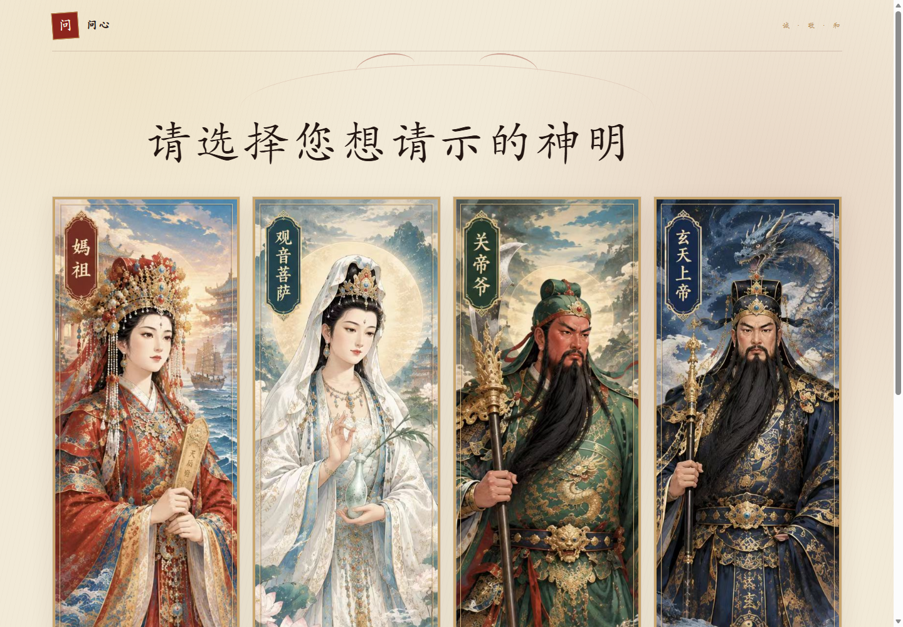
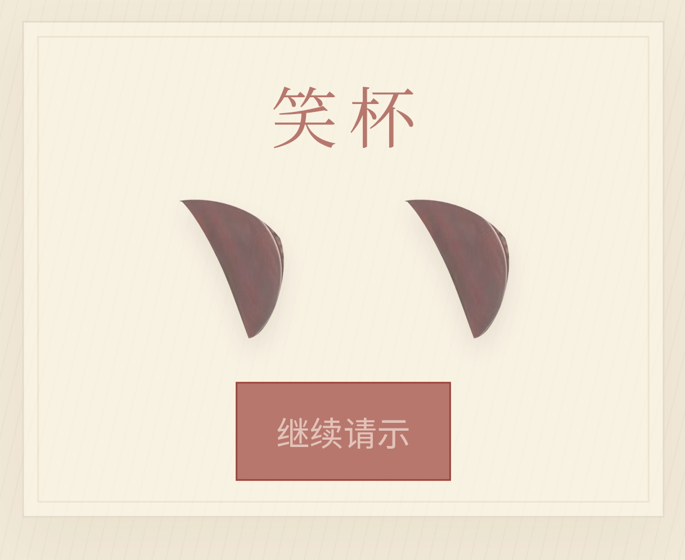

# 问心

一款完全离线的闽南四位神明数字掷杯体验应用。用户可以选择妈祖、观音菩萨、关帝爷或玄天上帝，输入一个只保留在当前页面中的问题，完成一次掷杯并查看圣杯、笑杯或阴杯。当前问题结束后可直接继续请示下一问。

网页本身使用原生 HTML、CSS 和 JavaScript；Android 安装包使用 Capacitor 将静态资源打包进应用内，不依赖服务器、账号、AI 接口或互联网。

## 这个项目是什么

“问心”是一款完全离线的闽南民俗掷杯体验应用。用户可以选择妈祖、观音菩萨、关帝爷或玄天上帝，写下当下想问的一件事，然后看到两枚筊杯落定后的杯象。

这个项目不是要替用户决定什么，也不是宣称能够预测未来。它更想提供一段简短的仪式化停顿：把模糊的担忧写成一个问题，安静片刻，看见一个不带解释的结果，再观察自己的第一反应。

它可能带来一定程度的心理慰藉，因为固定动作、等待和仪式感能够帮助人短暂集中注意力、整理情绪。但这是人的心理过程，不是杯象真的掌握了额外信息。它不提供心理治疗，也不能代替医疗、法律、财务或重大人生决策。

## 我们坚持的设计原则

- 每一个问题只能掷杯一次。
- 每一次掷杯都是独立事件，不读取上一次结果。
- 用户的问题、选择的哪位神明、希望出现哪种结果，都不能影响随机数。
- 不设置保底、补偿、暗改概率或“想要圣杯就更容易出圣杯”的规则。
- 结果只显示圣杯、笑杯或阴杯，不解释吉凶，不提供建议。
- 问题不上传、不保存，不调用 AI、账号或远程服务。
- 应用不代表官方宗教机构，也不宣称杯象等于真实的神明回应。

## 杯象与概率

两枚筊杯分别独立随机，平面和凸面各占 50%：

| 第一枚 | 第二枚 | 杯象 | 理论概率 |
|---|---|---|---|
| 平面 | 平面 | 笑杯 | 25% |
| 凸面 | 凸面 | 阴杯 | 25% |
| 平面 | 凸面 | 圣杯 | 25% |
| 凸面 | 平面 | 圣杯 | 25% |

因此圣杯的总概率是 50%，笑杯和阴杯各 25%。即使连续出现同一杯象，下一问的概率也不会改变。

<p>
  
  
</p>

## English overview

Wenxin is a fully offline Android and web experience inspired by the traditional Minnan practice of throwing two crescent-shaped jiaobei blocks. Users choose Mazu, Guanyin Bodhisattva, Lord Guan, or Xuantian Shangdi, enter a question that remains only on the current screen, and receive one of three cup outcomes.

This project is **not** a prediction service and does not claim to reveal divine will or future events. It creates a short ritual pause: users put a concern into words, watch the blocks settle, and observe their own reaction. That pause may provide psychological comfort through ritual and reflection, but it is not therapy and must not replace medical, legal, financial, or other real-world judgment.

Core rules:

- Each question permits exactly one throw.
- Every throw is independent and does not inspect previous results.
- The question, chosen deity, user preference, history, and time do not influence the random values.
- There is no forced outcome, pity system, probability adjustment, or desire-based favoritism.
- Two flat faces produce a laughing cup; two round faces produce a yin cup; one flat and one round produce a sacred cup.
- Sacred cup has a 50% theoretical probability because it covers two equally likely face combinations. Laughing cup and yin cup are each 25%.
- Results are displayed without fortune-telling, advice, or supernatural interpretation.
- Questions are never uploaded or stored. The app contains no account system, AI API, analytics, or remote service.
- The app does not represent an official religious institution.

## 功能

- 四位神明与完整本地人物素材。
- 本地随机生成两枚筊杯朝向。
- 平面 + 平面为笑杯。
- 凸面 + 凸面为阴杯。
- 一平一凸为圣杯。
- 同一个问题只能掷杯一次。
- 结果后可直接继续请示下一问。
- 问题不发送、不保存、不写入 Cookie 或 localStorage。
- Android 7.0 及以上，完全断网可运行。

## 项目结构

```text
minnan-four-deities-v1/   网页、测试、Capacitor 与 Android 工程
docs/PRIVACY.md           隐私政策
LICENSE                   MIT 许可证
```

详细开发说明见 [minnan-four-deities-v1/README.md](minnan-four-deities-v1/README.md)。

## 本地运行

```powershell
cd minnan-four-deities-v1
npm install
npm start
```

打开 `http://127.0.0.1:8765`。

## 构建 Android APK

```powershell
cd minnan-four-deities-v1
npm ci
npm run android:debug
```

APK 输出：

```text
android/app/build/outputs/apk/debug/app-debug.apk
```

独立发布包会复制到 `dist/wenxin-debug.apk`。也可以用 Android Studio 打开 `minnan-four-deities-v1/android` 后构建。

## 测试

```powershell
cd minnan-four-deities-v1
npm test
npm run scan:secrets
```

浏览器验收需要 Microsoft Edge。真机 WebView 验收脚本位于 `minnan-four-deities-v1/scripts/android-webview-smoke.mjs`。

## 图片与内容说明

人物与庙宇图像由项目维护者使用 GPT 图像生成能力制作并用于本项目；筊杯来自项目维护者提供的实物参考图裁切。图片是艺术化数字素材，不是宗教机构发布的正式造像，也不代表历史考据结论。

应用仅提供数字模拟体验，不代表真实的神明回应，不提供吉凶解释，不涉及付费解签、赌博或医疗建议。

这些视觉素材随本仓库公开供本项目使用。单独提取、再分发或用于其他商业项目前，请自行确认适用的生成服务条款及所在地法律要求。

## 隐私

应用完全在本地运行。用户输入的问题不会发送到服务器，也不会被保存。完整说明见 [隐私政策](docs/PRIVACY.md)。

## 许可证

源代码以 [MIT License](LICENSE) 开源。第三方依赖继续遵循各自许可证。
